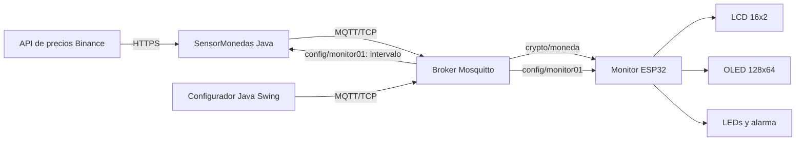

# Monitor de Criptomonedas con MQTT

Proyecto académico de monitoreo de precios de criptomonedas. El sistema consulta precios de Binance, los distribuye mediante MQTT y los presenta en un dispositivo basado en ESP32. Una aplicación de escritorio permite cambiar las monedas y configurar las alertas sin modificar el firmware.

## Funcionalidades

- Consulta periódica de BTC, SOL, ETH, XRP, ADA y DOGE frente a USDT mediante la API pública de Binance.
- Publicación de precios en tópicos MQTT separados por moneda.
- Visualización en una pantalla LCD 16x2 y una OLED 128x64 con historial de tendencia.
- Selección de dos monedas mediante botones físicos.
- Indicadores LED para mostrar si el precio sube, baja o se mantiene estable.
- Alarma sonora con límites configurables, duración, volumen por software y modos `MAX` y `MIN`.
- Configuración remota de monedas, límites, alarma e intervalo de consulta.

## Arquitectura



## Componentes principales

- **SensorMonedas:** aplicación Java que consulta los precios y publica actualizaciones. También se suscribe a la configuración para ajustar el intervalo de consulta en tiempo real.
- **Configurador:** aplicación de escritorio Java Swing para seleccionar las monedas asignadas a los botones, definir límites, duración y volumen de alarma, elegir el modo `MAX` o `MIN` y cambiar el intervalo.
- **Mosquitto:** broker MQTT que recibe y distribuye precios y configuraciones.
- **Monitor ESP32:** cliente MQTT que muestra los precios y aplica la configuración recibida.

## Tópicos MQTT

| Tópico | Publicador | Contenido |
|---|---|---|
| `crypto/btc` | SensorMonedas | Precio de Bitcoin en USDT |
| `crypto/sol` | SensorMonedas | Precio de Solana en USDT |
| `crypto/eth` | SensorMonedas | Precio de Ethereum en USDT |
| `crypto/xrp` | SensorMonedas | Precio de XRP en USDT |
| `crypto/ada` | SensorMonedas | Precio de Cardano en USDT |
| `crypto/doge` | SensorMonedas | Precio de Dogecoin en USDT |
| `config/monitor01` | Configurador | Configuración JSON del Monitor y el intervalo de SensorMonedas |

Ejemplo del mensaje publicado en `config/monitor01`:

```json
{
  "moneda1": "BTC",
  "moneda2": "SOL",
  "limite1": 95000,
  "limite2": 200,
  "duracionAlarmaSeg": 5,
  "volumenAlarma": 53,
  "modoAlerta": "MAX",
  "intervaloSeg": 30
}
```

`MAX` activa la alarma cuando el precio alcanza o supera el límite. `MIN` la activa cuando cae hasta el límite o por debajo. `intervaloSeg` se expresa en segundos y controla la frecuencia de consulta de SensorMonedas.

## Hardware del Monitor

- ESP32 DevKit V1
- LCD 16x2 con adaptador I2C
- OLED 128x64 con I2C
- Dos pulsadores
- LED verde, rojo y blanco con resistencias limitadoras
- Amplificador de audio PAM8302A y transductor sonoro
- Protoboard, cables de conexión y alimentación USB

## Software y bibliotecas

- Java y Maven para SensorMonedas y Configurador.
- Arduino IDE para compilar y cargar el firmware en el ESP32.
- Bibliotecas Arduino: `PubSubClient`, `ArduinoJson`, `LiquidCrystal_I2C`, `Adafruit GFX` y `Adafruit SSD1306`.
- Broker MQTT Mosquitto, puerto TCP 1883 en el entorno local de desarrollo.

## Puesta en marcha

1. Instala y ejecuta Mosquitto. Configura un listener MQTT accesible desde la computadora y desde el ESP32.
2. Ejecuta SensorMonedas. Si corre en el mismo computador que Mosquitto, puede conectarse a `tcp://localhost:1883`.
3. Abre el proyecto del Configurador y ejecuta `Main`. Confirma la dirección del broker y el tópico `config/monitor01`.
4. En el firmware del ESP32 configura el nombre y la contraseña de Wi-Fi y la dirección IP local del computador que ejecuta Mosquitto.
5. Carga el firmware al ESP32, abre el Monitor Serie a 115200 baudios y verifica la conexión Wi-Fi y MQTT.
6. Usa el Configurador para enviar monedas y parámetros. SensorMonedas y el Monitor ESP32 reciben la configuración desde el tópico retenido.

> El ESP32 no puede usar `localhost` para conectarse al broker: debe usar la dirección IP del computador donde corre Mosquitto. No publiques credenciales Wi-Fi ni contraseñas del broker en el repositorio.

## Pruebas realizadas

- Conexión de SensorMonedas con Mosquitto y publicación de precios de las seis monedas.
- Recepción de cambios del intervalo de consulta desde el Configurador.
- Envío de la configuración JSON a `config/monitor01`.
- Recepción de precios y configuración en el ESP32.
- Verificación de pantallas, selección con botones, indicadores LED y alarma sonora.

Para la entrega académica, documenta cada prueba con su propósito, procedimiento, resultado observado y evidencia visual.
